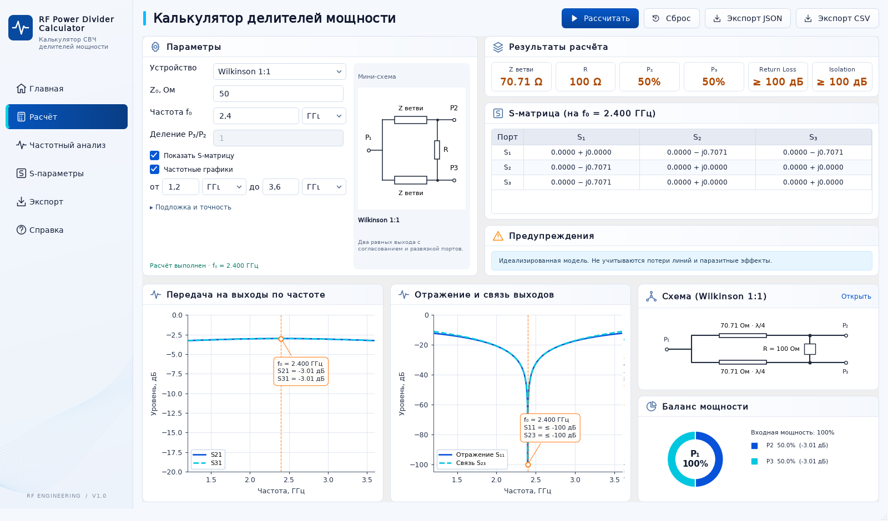

# Microwave Calculator

Настольное приложение для расчёта микрополосковых линий, четвертьволновых трансформаторов, делителей мощности и LC-фильтров. Поддерживаемый сценарий запуска описан для Windows x64.



## Запуск из папки проекта

Для нового окружения нужен Python 3.11–3.13. Выполните в PowerShell:

```powershell
python -m venv .venv
.\.venv\Scripts\python.exe -m pip install -r requirements.txt
.\.venv\Scripts\python.exe -m microwave_calculator
```

На компьютере с уже установленными зависимостями достаточно команды `python -m microwave_calculator`. Для самих расчётов доступ к сети не требуется.

## Работа с приложением

1. Выберите устройство или режим анализа/синтеза линии.
2. Введите параметры и выберите единицы рядом с полями. Десятичную дробь можно вводить с точкой или запятой.
3. Нажмите «Рассчитать» или Ctrl+Enter. В разделе «Расчёт» доступны сводка, S-матрица на центральной частоте, два частотных графика, расчётная схема и баланс мощности. Параметры подложки и число точек сетки раскрываются кнопкой «Подложка и точность». Флажки управляют отображением матрицы и частотных графиков. Кнопка «Сброс» восстанавливает исходные значения текущего режима.
4. Боковая навигация открывает частотный анализ, S-параметры с подробными результатами, экспорт и справку. Ссылка «Открыть» в карточке схемы показывает её крупно и позволяет переключаться между расчётной схемой с номиналами и рисунком из книги Дэвида Позара (4-е издание). Раздел «Главная» содержит быстрый выбор модулей.
5. JSON сохраняет исходные данные и результаты на центральной частоте, CSV — точки частотной сетки. На странице схемы экспорт PNG сохраняет выбранную схему, а в разделе «Экспорт» — графики либо выбранную схему, если графиков нет. После изменения параметров экспорт доступен по завершении нового расчёта.

Для демонстрации задайте 2,4 ГГц, подложку 0,8 мм с относительной проницаемостью 3,55 и опорное сопротивление 50 Ом. Рассчитайте линию на 50 Ом и трансформатор для нагрузки 100 Ом. Затем сравните Т-делитель и Уилкинсон при отношении мощностей P₃/P₂ = 1 и 2. У идеального Уилкинсона при r = 2 на центральной частоте выходы получают 1/3 и 2/3 падающей мощности.

## Из калькулятора в Ansys HFSS

1. Рассчитайте микрополосковую линию (анализ или синтез), Т-делитель или двухвыходной Wilkinson (равный или неравный). На странице **Экспорт → Экспорт HFSS** сохраните скрипт `.py` в папку, куда разрешена запись.
2. В Ansys Electronics Desktop выберите **Tools → Run Script** и укажите этот файл. Скрипт предназначен для встроенного интерпретатора AEDT, не требует установки PyAEDT, создаёт **новый** проект и сохраняет `.aedt` рядом со скриптом. При повторном запуске к имени добавляется номер.
3. В HFSS откройте **Validation Check**, затем **Analyze All**. В **Results** уже созданы графики отражения, передачи и фазы; для делителей также доступны развязка, отношение выходных мощностей и разность фаз. До решения эти графики пусты. Создание проекта само по себе не запускает длительную симуляцию.

Размеры проводников, подложки, опорный импеданс, εr и частоты доступны как переменные проекта или дизайна. **Setup1** — адаптивное решение Driven Modal на f₀, **Sweep** — интерполирующая развёртка по сетке калькулятора. При ручной смене f₀ в HFSS обновите также частоту в Setup1: AEDT 2024 R1 принимает её как число с единицами. Для одиночной линии, где в калькуляторе нет сетки или длины, приняты длина λg/4 и диапазон 0,5–1,5 f₀ (201 точка).

Это стартовая электромагнитная модель: металл — идеальные листы PEC без толщины, подложка без потерь, земля конечная, порты сосредоточенные, область воздуха открытая. Для Wilkinson используется идеальный сосредоточенный резистор без корпуса. Подводы, изгибы и взаимная связь входят в 3D-модель, поэтому графики не обязаны совпадать с идеальным расчётом. При изменении геометрии проверьте направления портов и резистора перед решением. Для новых исходных требований надёжнее пересчитать и заново экспортировать. Для LC-фильтров, отдельного трансформатора, резистивной звезды и N-выходного Wilkinson разводка в этой версии не задана.

Вместо N-way доступен двухвыходной Wilkinson с 1–8 секциями в каждом плече. Введите два списка через точку с запятой: волновые сопротивления Z и мостовые резисторы R в омах, от выходов к входу. Число пар определяет число секций. По умолчанию загружены семь пар из Wilkinson101-Rev1-3, 50 Ом, 5,5 ГГц и 201 точка от 4,9 до 6 ГГц. Это анализ заданных номиналов, не автоматический синтез по полосе. HFSS-экспорт для многосекционной разводки недоступен. Резистивный делитель и LC-фильтры остаются отдельными режимами.

## Проверка и устройство проекта

```powershell
.\.venv\Scripts\python.exe -m pytest -q
```

`core.py` содержит модели, проверку физических параметров и типы данных. `ui.py` преобразует единицы и связывает режимы с ядром. `plots.py` строит изображения, а `export.py` записывает данные, не обращаясь к интерфейсу. См. [описание моделей и контрактов](docs/models.md) и [план испытаний](docs/verification.md).

Границы первой версии, шестинедельный план и распределение обязанностей приведены в [ТЗ](TZ.md).
